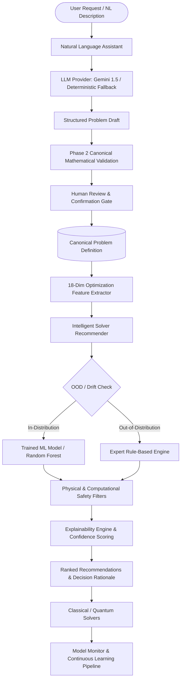

# AI and Machine Learning Intelligence Layer

## 1. Overview and Mission

The **AI and Machine Learning Intelligence Layer** (Phase 7) enhances the Q-Optimize platform with two mission-critical, scientifically grounded capabilities:

1. **Natural Language Optimization Assistant (Capability A):** Translates unstructured human language problem descriptions into mathematically validated canonical problem instances (Max-Cut, Assignment, TSP) with full entity extraction, assumption disclosure, missing information detection, and mandatory human confirmation.
2. **Intelligent Solver Recommendation Engine (Capability B):** Uses supervised machine learning trained on actual empirical execution data (Phase 4 classical solvers, Phase 5 standard QAOA, Phase 6 adaptive QAOA) and transparent expert rules to recommend optimal solvers, complete with explainability, confidence scores, out-of-distribution (OOD) safeguards, and continuous learning monitoring.



---

## 2. Capability A: Natural Language Optimization Assistant

### 2.1 Core Architectural Principles
- **Untrusted Input Treatment:** All natural language inputs are treated as raw, untrusted text. They are sanitized, length-limited (<= 4000 characters), and validated.
- **Provider Abstraction (`ILLMProvider`):** Modular provider interface supporting Google Gemini (`GeminiLLMProvider`), deterministic regex/heuristic fallback (`DeterministicFallbackParser`), and mock test providers (`MockLLMProvider`).
- **No Hallucinated Parameters:** Missing edge weights, costs, and distances are never silently fabricated. Missing data is explicitly reported in `missing_information`, and any structural defaults (e.g. Euclidean metrics, unit costs) are explicitly documented in `assumptions`.
- **Phase 2 Mathematical Validation Gate:** Every draft generated by any LLM or heuristic is immediately subjected to the deterministic Phase 2 validators (`ProblemService.validate_problem_definition`). If mathematical invariants are violated, the draft is marked `INVALID` with precise error issues.
- **Mandatory Human Confirmation:** The draft is never committed directly to the database. The user must review, optionally edit the JSON instance, and click "Confirm & Create Problem".

### 2.2 Draft Proposal Schema (`ProblemDraftProposal`)
```json
{
  "problem_type": "max_cut",
  "is_supported": true,
  "name": "Cluster Partitioning Problem",
  "description": "Partition 4 compute nodes to maximize crossing bandwidth",
  "entities": {
    "nodes": ["Node_1", "Node_2", "Node_3", "Node_4"]
  },
  "objective": {
    "direction": "maximize",
    "description": "Maximize total weight of cut edges between disjoint partitions"
  },
  "constraints": [
    "Binary partition assignment: each node assigned to cluster 0 or 1",
    "Undirected graph: edge weights are symmetric"
  ],
  "suggested_instance": {
    "nodes": ["Node_1", "Node_2", "Node_3", "Node_4"],
    "edges": [
      ["Node_1", "Node_2", 1.0],
      ["Node_2", "Node_3", 1.0],
      ["Node_3", "Node_4", 1.0],
      ["Node_4", "Node_1", 1.0]
    ]
  },
  "missing_information": [
    "Explicit edge weights were not specified in the description; unit weights (1.0) were proposed."
  ],
  "assumptions": [
    "Assumed simple cycle graph topology connecting nodes in sequence."
  ],
  "confidence_score": 0.85,
  "requires_user_confirmation": true,
  "validation_status": "VALID",
  "is_mathematically_valid": true,
  "validation_issues": []
}
```

---

## 3. Capability B: Intelligent Solver Recommender

### 3.1 18-Dimensional Feature Representation
Features are strictly computed prior to solver execution to ensure zero data leakage:

| Index | Feature Key | Dimension / Unit | Description |
|---|---|---|---|
| 0 | `problem_type` | Categorical (0, 1, 2) | 0=Max-Cut, 1=Assignment, 2=TSP |
| 1 | `num_variables` | Integer >= 1 | Number of decision variables in canonical formulation |
| 2 | `num_constraints` | Integer >= 0 | Number of hard constraints |
| 3 | `constraint_density` | Float [0, 1] | Ratio of constraints to variables |
| 4 | `estimated_search_space_log2` | Float >= 0.0 | Log2 of theoretical solution space size |
| 5 | `graph_density` | Float [0, 1] | Graph edge or cost matrix sparsity/density |
| 6 | `graph_avg_degree` | Float >= 0.0 | Mean node degree or connectivity |
| 7 | `graph_degree_variance` | Float >= 0.0 | Variance of degree distribution |
| 8 | `coeff_mean` | Float | Mean of objective coefficients / edge weights |
| 9 | `coeff_std` | Float >= 0.0 | Standard deviation of weights / costs |
| 10 | `coeff_min` | Float | Minimum cost / weight |
| 11 | `coeff_max` | Float | Maximum cost / weight |
| 12 | `coeff_range` | Float >= 0.0 | Spread (max - min) |
| 13 | `qubo_num_variables` | Integer >= 0 | QUBO decision variable count |
| 14 | `qubo_interaction_density`| Float [0, 1] | Fraction of non-zero quadratic couplings in Q |
| 15 | `ising_num_spins` | Integer >= 0 | Number of Pauli-Z spins in Ising Hamiltonian |
| 16 | `required_qubits` | Integer >= 0 | Qubit register requirement |
| 17 | `estimated_circuit_depth_p1`| Integer >= 1 | Estimated gates/depth for p=1 QAOA circuit |

### 3.2 Solver Selection Policy
To train supervised models without bias, the ground-truth "best" solver is selected using a Pareto efficiency policy:
1. **Feasibility:** Infeasible executions receive an infinite penalty.
2. **Solution Quality:** For minimization, lowest objective value; for maximization, highest objective value.
3. **Runtime Tie-Breaking:** If solutions are within $\epsilon = 10^{-4}$ of each other, the faster solver wins.
4. **Pareto Dominance:** Solvers achieving near-optimal quality within orders-of-magnitude less CPU time receive positive selection weight.

### 3.3 Leakage-Free Dataset Splitting
- **Group-Aware Splitting:** Splitting is performed across problem instance IDs or graph topology seeds, rather than individual execution runs. All runs associated with instance `X` are placed wholly in either the train set or test set, preventing cross-fold memorization.

### 3.4 Out-of-Distribution (OOD) Safeguards
- Feature distributions of the training set are tracked (mean $\mu_j$, standard deviation $\sigma_j$).
- For incoming problem instances, feature z-scores are calculated:
  $$z_j = \frac{|x_j - \mu_j|}{\sigma_j}$$
- If $\max_j(z_j) > 3.5$, the instance is flagged as Out-of-Distribution:
  1. The ML model is bypassed.
  2. The recommendation is delegated to the expert `RuleBasedSolverRecommender`.
  3. The user is issued an OOD alert explaining which features deviated from training norms.

### 3.5 Hard Safety Ceilings
Physical and simulation boundaries strictly override ML predictions:
- **Exact Solver:** Disabled for Max-Cut with $n > 20$, TSP with $n > 10$.
- **Quantum Simulators (Standard QAOA & Adaptive QAOA):** Disabled when required qubits $> 20$ (CPU Aer simulation ceiling).

### 3.6 Explainability & Calibration
- **Explainability Engine:** Translates scikit-learn feature importances (MDI) or tree routing into human-readable rationales highlighting the top 3 driving features.
- **Brier Score Calibration:** Evaluates probability calibration across multi-class predictions:
  $$\text{Brier} = \frac{1}{N} \sum_{i=1}^N \sum_{k=1}^K (p_{ik} - y_{ik})^2$$

---

## 4. REST API Specification

| Endpoint | Method | Purpose |
|---|---|---|
| `/api/v1/ai/assistant/parse` | `POST` | Parse unstructured text into structured, validated problem draft |
| `/api/v1/ai/assistant/validate-draft` | `POST` | Deterministically validate a modified problem draft |
| `/api/v1/ai/recommend` | `POST` | Generate ranked solver recommendations with explanation |
| `/api/v1/ai/models` | `GET` | List registered AI/ML models and active metadata |
| `/api/v1/ai/models/{model_id}/activate` | `POST` | Set specific trained model as active production recommender |
| `/api/v1/ai/train` | `POST` | Train or retrain ML recommender on historical experiment data |
| `/api/v1/ai/feedback` | `POST` | Record user solver selection, realization, and acceptance |
| `/api/v1/ai/monitoring` | `GET` | Query drift metrics, feedback acceptance rates, and model health |
| `/api/v1/ai/retrain` | `POST` | Trigger continuous learning pipeline evaluation and promotion |
| `/api/v1/ai/rollback` | `POST` | Safely roll back active model to previous stable version |

---

## 5. Monitoring and Continuous Learning Pipeline

- **Audit Logging:** Every recommendation is assigned a unique UUID and logged with problem features, predicted probabilities, timestamp, and active model version.
- **Feedback Loop:** When users execute solvers, realized objective values, feasibility, and runtimes are captured.
- **Feature Drift Detection:** Continuous two-sample Kolmogorov-Smirnov (KS) tests assess whether recent query feature distributions diverge significantly ($p < 0.05$) from baseline training data.
- **Safe Promotion Gating:** Retrained candidate models are evaluated on a reserved holdout set. If candidate accuracy/regret improves over the baseline by at least $\Delta \ge 0.02$, the candidate is promoted; otherwise, promotion is rejected.
- **Instant Rollback:** One-click automated rollback allows reverting to any prior registered model artifact.
