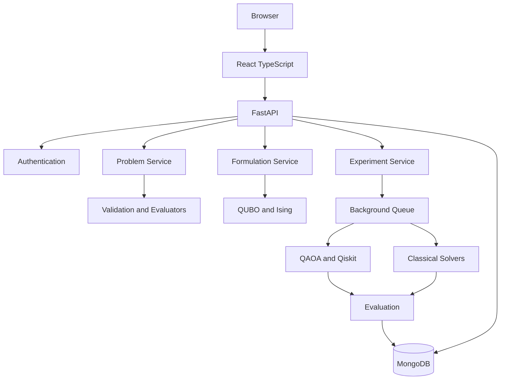
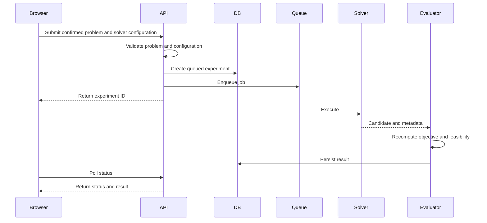

# System Architecture

## Architectural style
Start with a modular monolith. Use background jobs for long-running solver executions. Do not introduce microservices without a demonstrated need.

## High-level architecture


## Responsibilities
- **Frontend:** authentication, problem builder, formulation viewer, solver forms, job status, results, and visualizations.
- **API:** validation, authorization, versioned endpoints, job creation and status.
- **Problem domain:** canonical schemas, objective functions, feasibility checks.
- **Formulation domain:** QUBO encoders, QUBO-to-Ising conversion, variable ordering, penalty metadata.
- **Solver domain:** common interface, QAOA/classical adapters, configuration validation, timeout handling.
- **Evaluation:** independently recompute objective and feasibility; compute documented metrics.
- **Persistence:** users, problems, experiments, job status, and results.

## Repository structure
```text
Q-Optimize/
├── frontend/
├── backend/
├── research/
├── docs/
└── project_docs/
```

## Execution lifecycle


## Design constraints
Use a canonical problem representation independent of solver choice. The evaluator is the source of truth. Record variable ordering and bitstring convention. Keep quantum dependencies isolated. Enforce per-user resource ownership.
